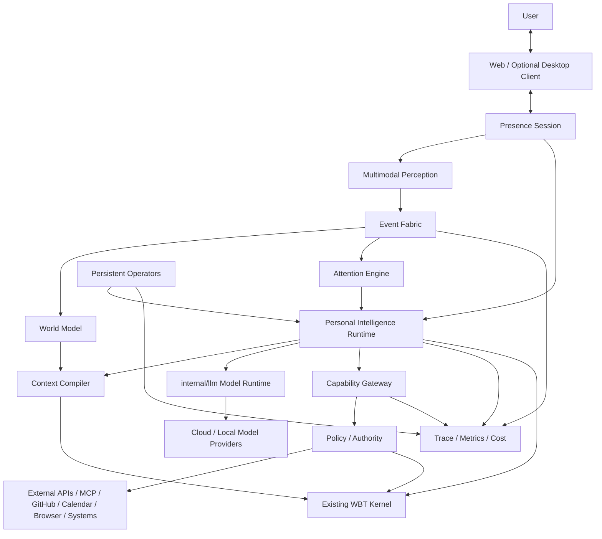

# Target Architecture



## Three planes

### 1. State plane
Existing WBT durable domains + World Model.

### 2. Control plane
Go:
- Runtime
- Operators
- Events
- Attention
- Capabilities
- Policy
- Trace

### 3. Media/inference plane
Replaceable:
- realtime audio
- VLM/image
- speech
- cloud reasoning
- local inference

## Split-plane realtime principle

Low-latency media may travel directly:

```text
Browser ── ephemeral credential ──> Realtime Provider
```

Control and authority remain:

```text
Browser / model intent
        ↓
WBT backend
        ↓
Capability + Policy + Trace
```

The browser never becomes the authority boundary.
